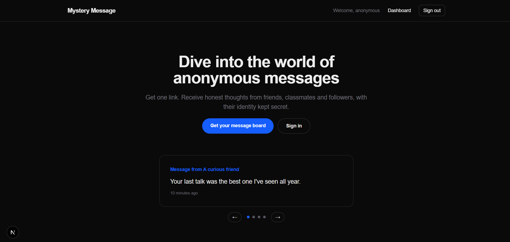

# Mystery Message

An anonymous messaging app. Sign up, get a personal link, and receive honest messages from anyone without them revealing who they are.

**Live demo:** <your-deployed-url>



## Features

- **Authentication** with [better-auth](https://www.better-auth.com/):
  - Email and password, with **email verification by link** (sign-in is blocked until the email is verified)
  - Sign in with **email or username** in a single field
  - **Google** and **GitHub** login
  - **Forgot and reset password** by emailed link (expires in 1 hour)
- **Personal public page** at `/u/<username>` where anyone can send an anonymous message, with tap-to-use prompt suggestions
- **Dashboard** to copy your link, pause or resume incoming messages, refresh, and delete messages (owner-only)
- **Username onboarding** for social sign-ups, with a live availability check
- **Abuse protection:** per-IP rate limiting on the public send endpoint, input validation on every route
- Responsive UI with light and dark mode, custom 404 and error pages

## Tech Stack

| Area | Tools |
| --- | --- |
| Framework | Next.js 16 (App Router, Cache Components), React, TypeScript |
| Styling | Tailwind CSS 4 |
| Auth | better-auth (email/password, username plugin, Google, GitHub) |
| Database | MongoDB (Mongoose for messages, native driver for better-auth) |
| Email | Resend + React Email |
| Validation | Zod |

## Getting Started

### Prerequisites

- Node.js 20 or newer
- A MongoDB database (a free MongoDB Atlas cluster works)
- A Resend account and API key
- (Optional) GitHub and Google OAuth apps for social login

### Installation

```bash
git clone https://github.com/aayushG301/Mystery-Message.git
cd mystery-message
npm install
cp .env.example .env
```

Fill in `.env` (see below), then start the dev server:

```bash
npm run dev
```

Open [http://localhost:3000](http://localhost:3000).

### Environment variables

| Variable | Description |
| --- | --- |
| `DB_URI` | MongoDB connection string. Include a database name at the end |
| `BETTER_AUTH_SECRET` | Random secret, e.g. `node -e "console.log(require('crypto').randomBytes(32).toString('base64'))"` |
| `BETTER_AUTH_URL` | Your app's base URL, e.g. `http://localhost:3000` (no trailing slash) |
| `RESEND_API_KEY` | API key from Resend |
| `GITHUB_CLIENT_ID` / `GITHUB_CLIENT_SECRET` | From your GitHub OAuth app |
| `GOOGLE_CLIENT_ID` / `GOOGLE_CLIENT_SECRET` | From your Google OAuth client |

Never commit your `.env` file.

### OAuth setup

Register these callback URLs with each provider (replace the host in production):

- GitHub: `http://localhost:3000/api/auth/callback/github`
- Google: `http://localhost:3000/api/auth/callback/google`

### Email sending

The sender is `onboarding@resend.dev`, which only delivers to your own Resend account's email. To email real users, verify a domain in Resend and update the `from` address in `src/helpers/sendVerificationEmail.ts` and `src/helpers/sendResetPasswordEmail.ts`.

## Scripts

| Command | What it does |
| --- | --- |
| `npm run dev` | Start the development server |
| `npm run build` | Create a production build |
| `npm run start` | Serve the production build |
| `npm run lint` | Run ESLint |

## Routes

| Route | Purpose |
| --- | --- |
| `/` | Landing page |
| `/sign-in`, `/sign-up` | Authentication |
| `/check-email` | "Verify your email" screen with resend |
| `/forgot-password`, `/reset-password` | Password recovery |
| `/onboarding` | Pick a username after social sign-up |
| `/dashboard` | Protected: link, accept toggle, messages |
| `/u/[username]` | Public page to send a message |

API routes live under `src/app/api`: `auth/[...all]`, `send-message`, `get-messages`, `delete-message/[messageId]`, `accept-messages`.

## Project Structure

```
emails/                      React Email templates (verification, password reset)
src/
├── app/                     Pages and API routes
├── components/              Client components and forms
├── helpers/                 Email sending helpers
├── lib/                     auth, auth-client, db, session, rate limiting
├── model/                   Mongoose models
├── schema/                  Zod schemas
├── types/                   Shared types
└── proxy.ts                 Redirects signed-out users away from protected routes
```

## How It Works

1. **Sign up:** the account is created unverified and a verification link is emailed through Resend.
2. **Verify:** clicking the link verifies the email, signs the user in, and redirects to the dashboard.
3. **Route protection:** `proxy.ts` does a fast session-cookie check, and each protected page and API route then validates the session against the database.
4. **Messaging:** visitors post to `/api/send-message`, which checks that the user exists and is accepting messages, then stores it. Messages are tied to the recipient's id and never to the sender.
5. **Privacy:** no information about the sender is stored. Deleting a message is restricted to its owner.

## Security Notes

- Passwords are hashed by better-auth, and email verification is required before password sign-in
- The `callbackUrl` parameter only accepts in-app paths, which prevents open redirects
- Password-reset requests give the same response whether or not an account exists
- The rate limiter is in-memory, which suits a single server. For multi-instance or serverless hosting, replace it with a shared store such as Redis


## License

MIT

## Author

**<Your Name>** · [GitHub](https://github.com/aayushG301) · [LinkedIn](https://www.linkedin.com/in/aayushgarg-tech/)